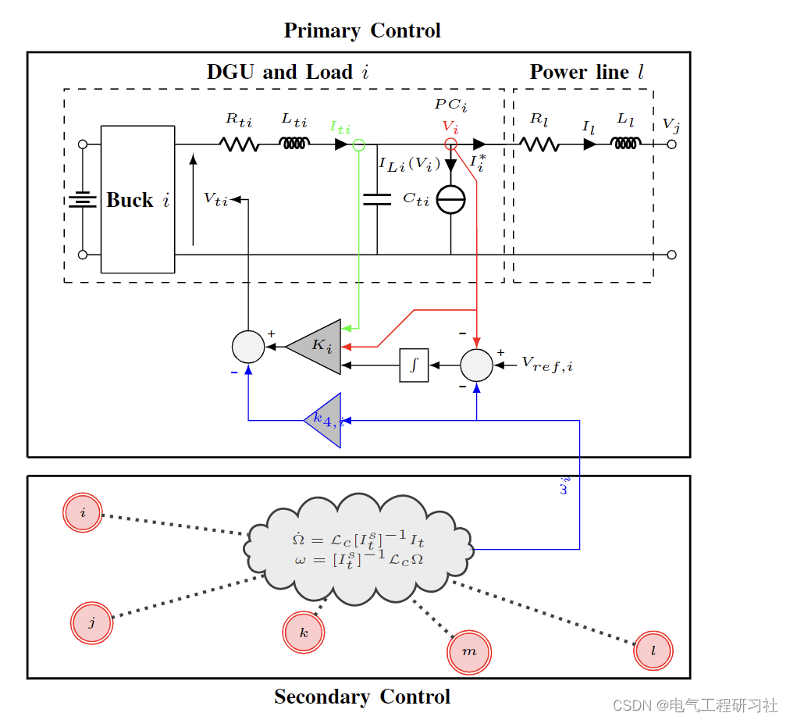
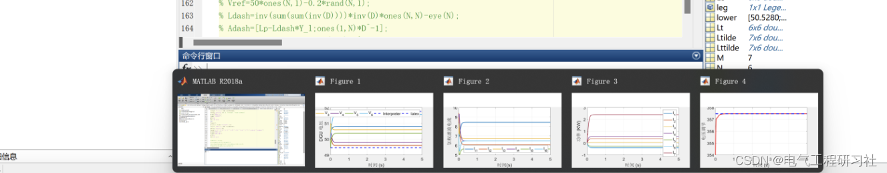
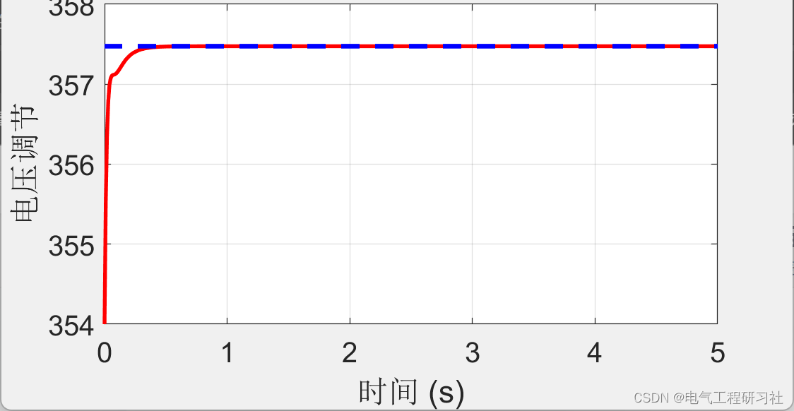
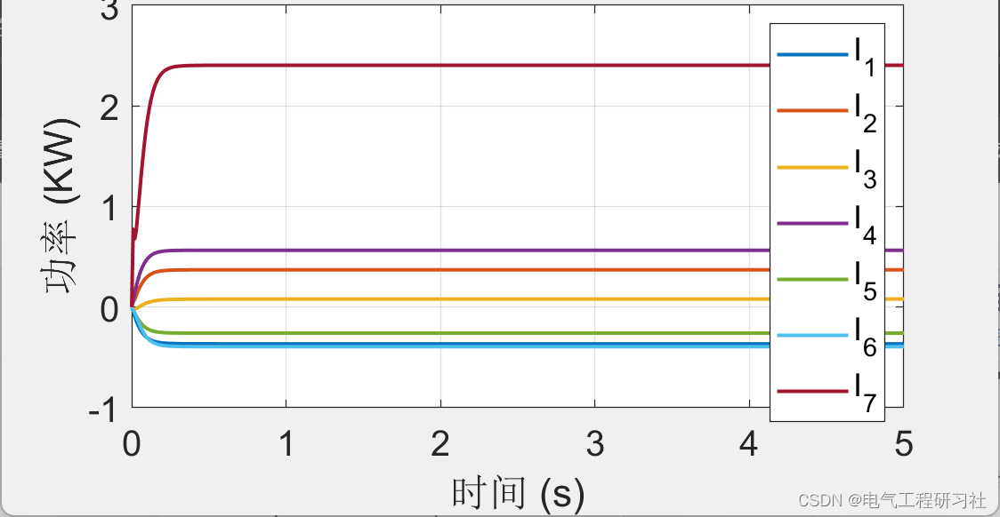
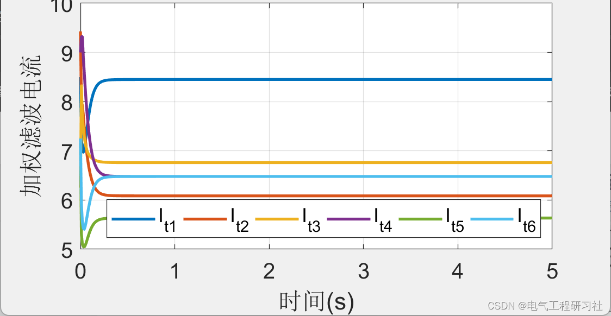
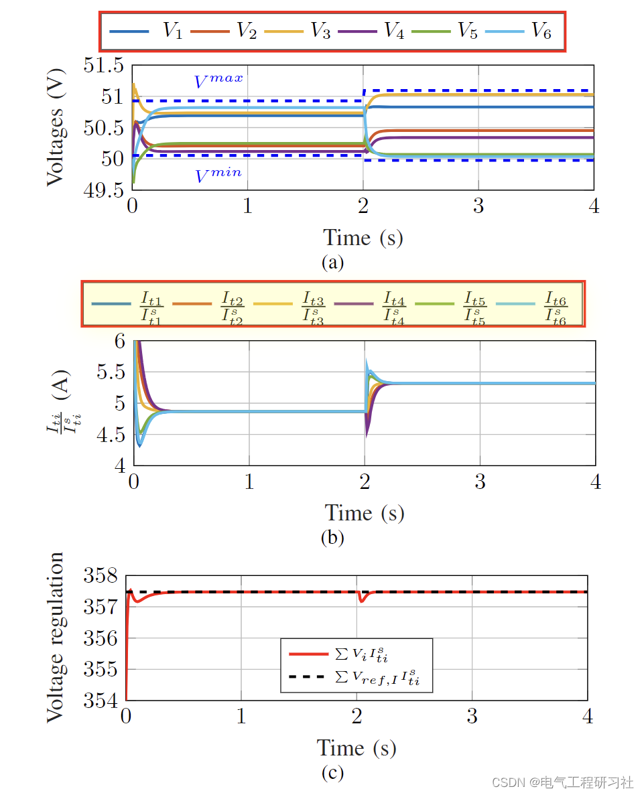
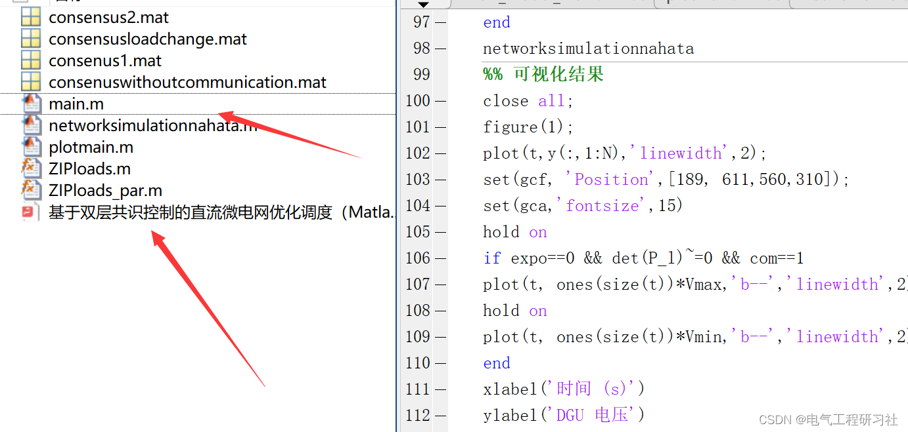

# Optimal Dispatch of DC Microgrid Based on Dual-Layer Consensus Control (Matlab Code Implementation)

1. Overview of Microgrids (mG)
1.1 The mG is a power grid composed of Distributed Generation Units (DGU), storage devices, and loads. In addition to numerous advantages such as renewable energy integration, improving electrical quality, reducing transmission losses, and operating in both grid-connected and islanded modes, they are also compatible with AC and DC operational standards [1]. Particularly, DC microgrids (DCmGs) have recently gained attention. Their increasing popularity can be attributed to the development of efficient converters, natural interfaces with renewable energy sources (e.g., photovoltaic modules) and batteries, and the availability of essentially DC electronic loads (various appliances, LEDs, electric vehicles, computers, etc.).
In islanded DCmGs, voltage stability is crucial as without it, voltage may exceed critical levels and damage connected loads [3]. Therefore, primary voltage control layers are typically used to track the required voltage reference at the coupling point (PC) to connect DGUs to DCmGs. Several methods have been proposed in the literature, such as PID control [2], [4] and plug-and-play control [5], [6]. Besides voltage stability, another ideal goal is to ensure current sharing, that is, DGUs must share the mG load according to their rated current. Indeed, unregulated currents can overload generators and ultimately lead to mG failures without it.
This paper proposes a novel secondary regulator for current sharing and voltage balancing in DC microgrids, consisting of distributed generators, dynamic RLC lines, and nonlinear ZIP (Zener-Capacitor-Inductor) loads. The proposed controller is situated above the primary voltage control layer and takes necessary control measures based on information exchanged through a communication network. We derive sufficient conditions for the existence and uniqueness of equilibrium points and demonstrate that the desired objectives are achieved under steady-state conditions. Our control design requires only local parameters of the generator sets, facilitating plug-and-play operation. We provide voltage stability analysis and illustrate the performance and robustness of our design through simulations. All results are applicable to any (although connected) microgrid and communication network topology. 2 Mathematical Model
Figure 1: A schematic diagram showing the main and secondary control layers of DCmG. Note that the topology of the communication network is not displayed.
Detailed mathematical models are presented in Section 4.
3 Operational Results
​
​
​
​
​
​
4 Matlab Code and Article Explanation
This article only showcases part of the code; all codes can be found in:

## Images

<!-- PAYMENT_BLOCK -->

## Get this dataset

- Payment link (Stripe): [Buy now](https://buy.stripe.com/3cs8yP7sY87d0vu9AB)
- Payment QR code: 

<!-- /PAYMENT_BLOCK -->
